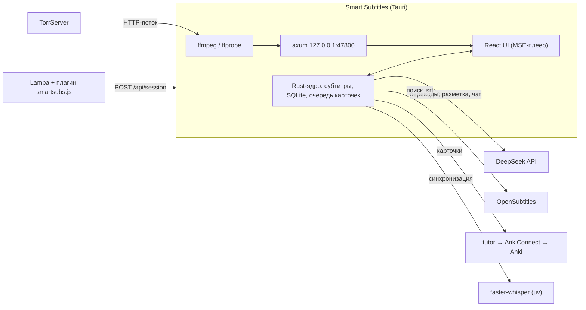

# Smart Subtitles

Плеер для Linux, на котором удобно учить английский по фильмам и сериалам. Он показывает английские субтитры с русским переводом. Перевод делает LLM с учётом контекста. Идиомы, фразовые глаголы и грамматические конструкции подсвечиваются. Любую фразу можно в один клик отправить в Anki вместе с аудиоклипом из сцены и картинкой.

Сделан на Tauri 2 (Rust) и React. Фильмы открываются из [Lampa](https://github.com/yumata/lampa) + [Lampa Desktop](https://github.com/Kolovatoff/lampa-desktop) через TorrServer или с диска.


<table>
  <tr>
    <td></td>
    <td></td>
  </tr>
  <tr>
    <td align="center">Чат с преподавателем (<code>C</code>)</td>
    <td align="center">Справка «Как читать подсветку» (<code>H</code>)</td>
  </tr>
</table>

## Возможности

- **Субтитры в два слоя.** Английский текст и разговорный русский перевод реплики; каждый слой включается отдельно (`E` / `T`).
- **Подсветка.** LLM размечает в репликах идиомы, фразовые глаголы, коллокации, сленг, редукции (`gonna`, `wanna`) и грамматику. Подчёркивание по цвету показывает тип. При наведении появляется объяснение в контексте сцены.
- **Конструкции.** Каталог из 48 грамматических конструкций (`src/modules/Patterns/patterns.json`). Плеер отмечает их в репликах и считает, сколько раз вы их встретили.
- **Слова из Anki.** Слова из вашей колоды, которые вы ещё учите, подсвечиваются в субтитрах. Режимы: только новые, все невыученные, выключено.
- **Караоке.** Уже произнесённые слова реплики подсвечиваются по ходу речи.
- **Панель «Диалоги»** (`S`). Весь сценарий с поиском. Клик по реплике перематывает к ней. Реплику можно повторить или послушать медленнее (0.75×).
- **Режим «скрыть субтитры».** Для тренировки на слух: реплика открывается по `A`.
- **Чат с преподавателем** (`C`). LLM-агент отвечает на вопросы о фильме и видит текущее место просмотра (без спойлеров дальше него). Может предложить карточки для Anki.
- **Карточки Anki в фоне.** «Добавить» ставит задачу в очередь и не тормозит просмотр. В карточку попадают клип сцены (WebM, ~40–100 КБ) и AI-картинка. Если что-то не получилось, придёт уведомление с кнопкой «Повторить».
- **Синхронизация субтитров.** Whisper распознаёт несколько фрагментов звука и сам находит сдвиг субтитров. Вручную сдвиг подстраивается клавишами `Z` / `X`.
- **Тяжёлое видео.** HDR → SDR через VAAPI, звук перекодируется в AAC, видео отдаётся потоком без скачивания файла целиком.
- **Встроенная справка** (`H`): как читать подсветку, с живыми примерами.

## Как это устроено



Субтитры ищутся в таком порядке:
1. Файл субтитров из той же раздачи (его передаёт Lampa).
2. OpenSubtitles (по хэшу файла и TMDB ID, для сериалов — с сезоном и серией).
3. Кнопка «Загрузить .srt…».

Встроенные дорожки MKV не извлекаются: для этого пришлось бы скачать весь фильм.

## Требования

Проверено на Fedora. На других дистрибутивах нужны те же библиотеки под своими именами. Про macOS см. [Сборка для macOS](#сборка-для-macos).

| Компонент | Зачем | Обязателен |
|---|---|---|
| `webkit2gtk4.1-devel`, `librsvg2-devel`, `libappindicator-gtk3-devel` | сборка Tauri | да |
| Rust ≥ 1.90, Node.js ≥ 20 | сборка | да |
| `ffmpeg`, `ffprobe` | видео, звук, клипы | да |
| ключ [DeepSeek API](https://platform.deepseek.com) | перевод, подсветка, чат | без него только субтитры |
| ключ [OpenSubtitles API](https://www.opensubtitles.com/consumers) | поиск субтитров | нет |
| [TorrServer](https://github.com/YouROK/TorrServer) + Lampa | просмотр торрентов | нет (можно открыть файл с диска) |
| [`uv`](https://docs.astral.sh/uv/) | автосинхронизация (окружение с faster-whisper ставится само в `~/.cache/smart-subtitle/asr`) | нет |
| VAAPI (`/dev/dri/renderD128`) | HDR → SDR | только для HDR |
| Anki + [AnkiConnect](https://ankiweb.net/shared/info/2055492159) (`127.0.0.1:8765`) и tutor (`127.0.0.1:4820`) | карточки | нет |

```sh
sudo dnf install webkit2gtk4.1-devel librsvg2-devel libappindicator-gtk3-devel ffmpeg
```

## Установка

```sh
git clone https://github.com/Tomato1337/smart-subtitle.git
cd smart-subtitle
npm install

npm run tauri dev       # запуск в режиме разработки
npm run build:rpm       # RPM-пакет в src-tauri/target/release/bundle/rpm/
sudo dnf install ./src-tauri/target/release/bundle/rpm/smart-subtitle-0.1.0-1.x86_64.rpm
```

Пакет ставит `/usr/bin/smart-subtitle`, ярлык в меню и обработчик ссылок `smartsubs://`.

### Сборка для macOS

Тот же код собирается и под macOS (Apple Silicon и Intel). Готовых сборок нет, только из исходников.

1. Установите инструменты:

   ```sh
   xcode-select --install                 # компилятор и SDK
   curl --proto '=https' --tlsv1.2 -sSf https://sh.rustup.rs | sh   # Rust ≥ 1.90
   brew install node ffmpeg uv            # uv нужен только для автосинхронизации
   ```

   Системные библиотеки, как на Linux, не нужны: Tauri использует встроенный WebKit.

2. Соберите приложение:

   ```sh
   npm install
   npm run build:mac
   ```

   Результат:
   - `src-tauri/target/release/bundle/macos/smart-subtitle.app`
   - `src-tauri/target/release/bundle/dmg/smart-subtitle_0.1.0_<arch>.dmg`

   Universal-сборка для обеих архитектур сразу:

   ```sh
   rustup target add aarch64-apple-darwin x86_64-apple-darwin
   npm run tauri build -- --bundles app,dmg --target universal-apple-darwin
   ```

3. Перетащите `smart-subtitle.app` в `/Applications`. Ссылки `smartsubs://`, которыми Lampa запускает приложение, macOS регистрирует только для установленного `.app`. В `npm run tauri dev` они не работают.

Что отличается от Linux:

- **ffmpeg из Homebrew.** Приложения, запущенные из Finder или Dock, получают урезанный `PATH` (`/usr/bin:/bin:/usr/sbin:/sbin`). Поэтому при старте приложение само дописывает в `PATH` `/opt/homebrew/bin` и `/usr/local/bin`, и `ffmpeg`, `ffprobe` и `uv` из Homebrew находятся. Если они установлены в другое место, запускайте приложение из терминала: `/Applications/smart-subtitle.app/Contents/MacOS/smart-subtitle`.
- **Подпись.** Сборка не подписана. Если вы перенесли `.app` или `.dmg` на другой Mac, снимите карантин: `xattr -cr /Applications/smart-subtitle.app`.
- **HDR.** VAAPI на macOS нет. Видео не в H.264 перекодируется программно (libx264) и нагружает процессор. HDR → SDR тонмаппинга нет, так что HDR-раздачи выглядят блёкло. Обычные H.264-раздачи идут без перекодирования, как на Linux.
- **Пути.** Настройки, база и логи лежат в `~/Library/Application Support/smart-subtitle/`, кэш — в `~/Library/Caches/smart-subtitle/`.
- **Тема.** Палитры inir нет, используются цвета из `src/app/styles/tokens.css`.

## Настройка

При первом запуске приложение создаёт `~/.config/smart-subtitle/config.json` (на macOS — `~/Library/Application Support/smart-subtitle/config.json`). Заполните нужные поля:

```json
{
  "llm": { "baseUrl": "https://api.deepseek.com", "apiKey": "sk-…", "model": "deepseek-flash" },
  "opensubtitles": { "apiKey": "…", "username": "", "password": "" },
  "lampa": { "origins": ["https://lampa.example.com"] },
  "torrserver": { "baseUrl": "https://example.com/tor", "username": "", "password": "" },
  "tutor": { "root": "/home/you/tutor", "apiUrl": "http://127.0.0.1:4820", "deck": "Learning English" },
  "learner": { "cefr": "A2" },
  "ffmpeg": { "vaapiDevice": "/dev/dri/renderD128" },
  "server": { "port": 47800 }
}
```

| Поле | Назначение |
|---|---|
| `llm.apiKey` | ключ DeepSeek; можно задать через переменную окружения `DEEPSEEK_API_KEY`. Подойдёт любой OpenAI-совместимый API, если поменять `baseUrl` и `model` |
| `opensubtitles.apiKey` | достаточно ключа; логин и пароль повышают дневную квоту скачиваний |
| `lampa.origins` | адреса Lampa, которым можно открывать фильмы в плеере. **Без этого поля плагин получит 403** |
| `torrserver.*` | Basic-auth, если TorrServer стоит за прокси. Логин и пароль подставляются только в URL под `baseUrl` |
| `tutor.*` | путь к tutor, его API и колода Anki |
| `learner.cefr` | уровень ученика (A1–C2): от него зависит, что подсвечивать и как объяснять |

Секреты хранятся только в этом файле, держите его с правами `chmod 600`. В логах логины и пароли из URL заменяются на `***`.

## Подключение к Lampa

1. Выложите `lampa-plugin/smartsubs.js` на свой сервер. Подойдёт тот же, где стоит Lampa.
2. В Lampa: **Настройки → Расширения → Добавить плагин**, укажите URL файла.
3. Впишите origin вашей Lampa в `lampa.origins`.

При запуске видео плагин предложит открыть его в Smart Subtitles и передаст название, сезон и серию, TMDB/IMDb ID, постер и плейлист. Если приложение не запущено, плагин поднимет его через `smartsubs://`.

Если Lampa открыта по `http`, плагин можно взять прямо из приложения: `http://127.0.0.1:47800/lampa/smartsubs.js`. По `https` Lampa переписывает адреса плагинов на `https://`, поэтому файл придётся выложить на сервер.

## Карточки Anki и tutor

Карточки создаёт tutor, отдельный сервис для изучения английского. Smart Subtitles вызывает его скрипт `flashcards.py`, а tutor пишет в Anki через AnkiConnect. Настройки картинок (бэкенд, модель) берутся из `GET <tutor.apiUrl>/api/settings`.

Без tutor всё остальное работает, только кнопка «Добавить» будет выдавать ошибку.

## Горячие клавиши

| Клавиша | Действие |
|---|---|
| `Space` | пауза / воспроизведение |
| `←` / `→` | предыдущая / следующая реплика |
| `Shift` + `←` / `→` | −5 / +5 секунд |
| `R` | повторить текущую реплику |
| `A` | показать скрытую реплику |
| `E` / `T` | английский / русский слой |
| `P` | подсветка конструкций |
| `S` | панель «Диалоги» |
| `C` | чат с преподавателем |
| `H` | справка по подсветке |
| `Z` / `X` | сдвиг субтитров −0.1 / +0.1 с |
| `[` / `]` | скорость −0.05 / +0.05 |
| `F` / `Esc` | полный экран / выход |

## Где лежат данные

Пути для Linux. На macOS `~/.config` заменяется на `~/Library/Application Support`, а `~/.cache` — на `~/Library/Caches`.

| Путь | Что |
|---|---|
| `~/.config/smart-subtitle/config.json` | настройки |
| `~/.config/smart-subtitle/data.db` | SQLite: история, позиции просмотра, переводы, чат |
| `~/.config/smart-subtitle/logs/` | `app.log`, `ffmpeg.log`, `llm.log` |
| `~/.cache/smart-subtitle/` | субтитры OpenSubtitles, клипы, окружение Whisper |

## Разработка

```
src/                 фронтенд, архитектура FEOD: common → modules → pages → app
  modules/           Player, Subtitles, Watch, Anki, Cards, Explain, Agent, Patterns, Session, Theme
src-tauri/src/       бэкенд на Rust
  media/             ffprobe, ffmpeg-поток (copy / VAAPI / x264), клипы
  subs/              разбор SRT/ASS/VTT, sidecar, OpenSubtitles, синхронизация
  llm/               клиент DeepSeek, разметка реплик, объяснения, агент
  asr/               faster-whisper и выравнивание слов
  tutor/             индекс Anki, очередь карточек
  server.rs          HTTP-сервер для Lampa и видеопотока
lampa-plugin/        плагин для Lampa
```

Фронтенд построен по [FEOD](https://github.com/Sdju/feod): у каждого модуля публичный API только через `index.ts`. Используются TypeScript 7, TanStack Router и Query, Tailwind 4. Линтер — oxlint, ESLint в проекте не используется.

Цвета интерфейса берутся из палитры оболочки inir на Quickshell (`~/.local/state/quickshell/user/generated`), если она есть; иначе из `src/app/styles/tokens.css`. `npm run gen-theme` обновляет этот файл по текущей палитре.

Проверки:

```sh
npm run type-check
npm run lint
npm test
cargo test --manifest-path src-tauri/Cargo.toml
```

## Лицензия

[MIT](LICENSE)
