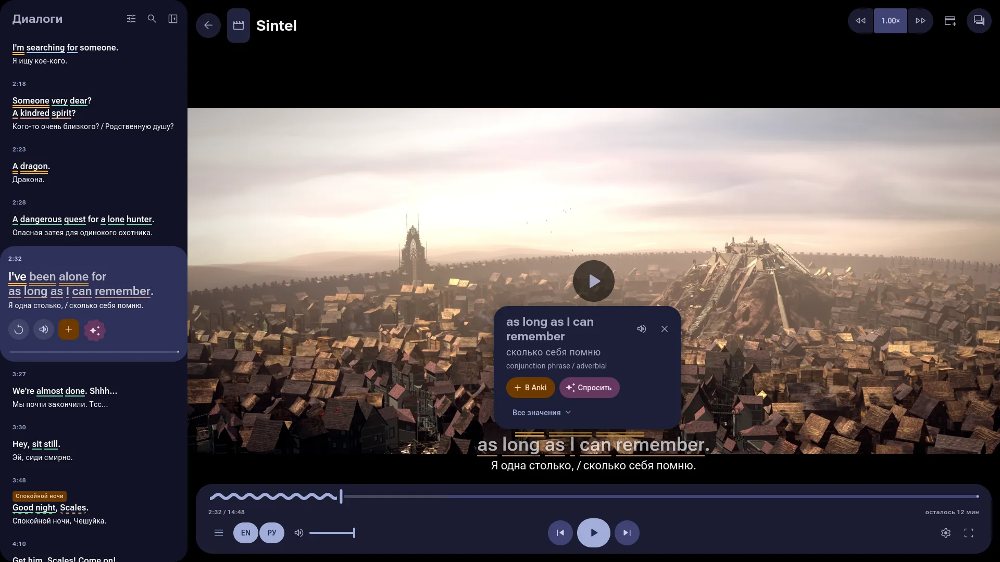
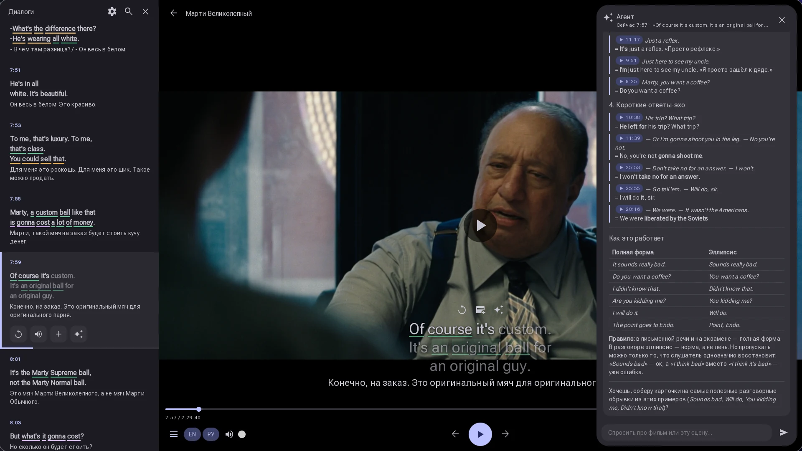
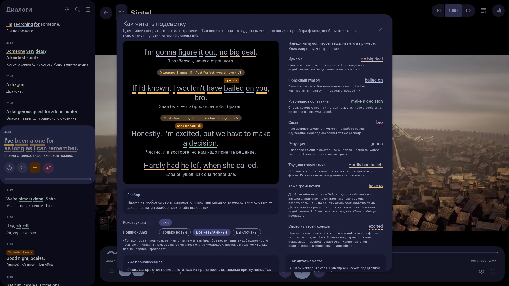
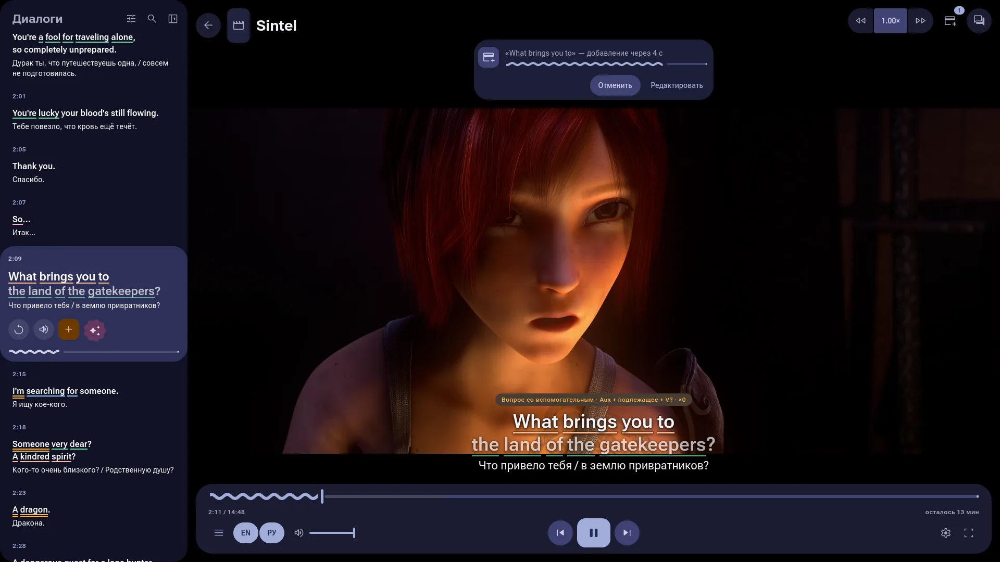
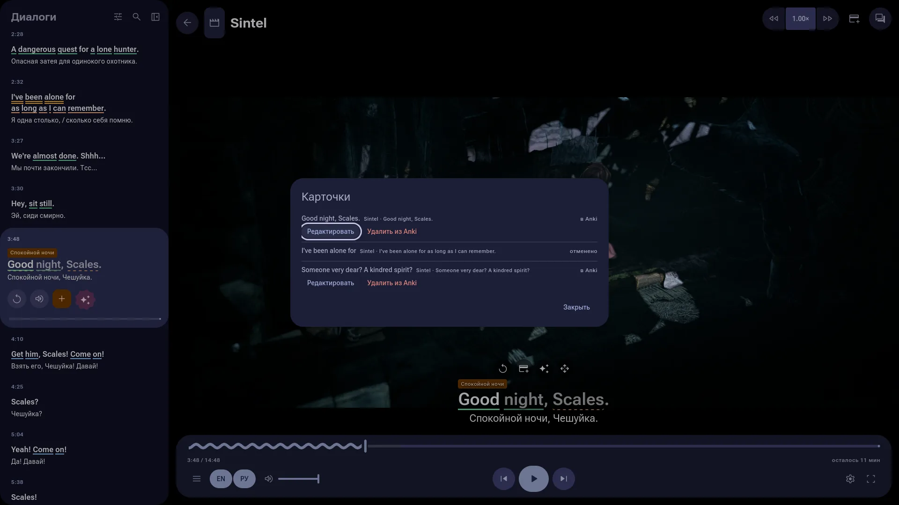
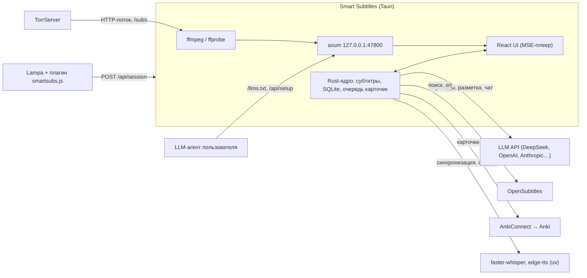

# Smart Subtitles

Плеер для Linux, macOS и Windows, на котором удобно учить английский по фильмам и сериалам. Он показывает английские субтитры с русским переводом. Перевод делает LLM с учётом контекста. Идиомы, фразовые глаголы и грамматические конструкции подсвечиваются. Любую фразу можно в один клик отправить в Anki вместе с аудиоклипом из сцены и картинкой.

Сделан на Tauri 2 (Rust) и React. Фильмы открываются из [Lampa](https://github.com/yumata/lampa) + [Lampa Desktop](https://github.com/Kolovatoff/lampa-desktop) через TorrServer или с диска.



<table>
  <tr>
    <td></td>
    <td></td>
  </tr>
  <tr>
    <td align="center">Чат с преподавателем (<code>C</code>)</td>
    <td align="center">Справка «Как читать подсветку» (<code>H</code>)</td>
  </tr>
  <tr>
    <td></td>
    <td></td>
  </tr>
  <tr>
    <td align="center">Быстрое добавление в Anki: пять секунд на отмену</td>
    <td align="center">«Последние карточки»: правка и удаление из Anki</td>
  </tr>
</table>

<sub>Кадры из фильма <a href="https://durian.blender.org/">Sintel</a> © Blender Foundation, <a href="https://creativecommons.org/licenses/by/3.0/">CC BY 3.0</a>.</sub>

## Возможности

- **Субтитры в два слоя.** Английский текст и разговорный русский перевод реплики; каждый слой включается отдельно (`E` / `T`).
- **Подсветка.** LLM размечает в репликах идиомы, фразовые глаголы, коллокации, сленг, редукции (`gonna`, `wanna`) и грамматику. Подчёркивание по цвету показывает тип. При наведении появляется объяснение в контексте сцены.
- **Конструкции.** Каталог из 48 грамматических конструкций (`src/modules/Patterns/patterns.json`). Плеер отмечает их в репликах и считает, сколько раз вы их встретили.
- **Слова из Anki.** Слова из ваших колод, которые вы ещё учите, подсвечиваются в субтитрах. Режимы: только новые, все невыученные, выключено.
- **Караоке.** Уже произнесённые слова реплики подсвечиваются по ходу речи.
- **Панель «Диалоги»** (`S`). Весь сценарий с поиском. Клик по реплике перематывает к ней. Реплику можно повторить или послушать медленнее (0.75×).
- **Режим «скрыть субтитры».** Для тренировки на слух: реплика открывается по `A`.
- **Чат с преподавателем** (`C`). LLM-агент отвечает на вопросы о фильме и видит текущее место просмотра (без спойлеров дальше него). Может предложить карточки для Anki. Внизу чата видно, сколько токенов и денег он потратил.
- **Карточки Anki в фоне.** «Добавить» ставит задачу в очередь и не тормозит просмотр. Приложение само пишет в Anki через AnkiConnect: слово, перевод, cloze-предложение, клип сцены (WebM, ~40–100 КБ), озвучка и AI-картинка. В режиме «Быстрое добавление» клик по слову сразу собирает карточку: пять секунд на «Отменить» или «Редактировать», без паузы и диалога. Все задачи видны в «Последних карточках» (кнопка в верхней панели): оттуда карточку можно открыть, поправить уже в Anki или удалить. Ошибки приходят в центр уведомлений.
- **Картинки с запасными провайдерами.** Если провайдер картинок не ответил, приложение повторяет запрос и переходит к следующему в настроенном порядке (OpenAI-совместимый, Runware, Gemini, omp).
- **Субтитры из раздачи и из видео.** Файлы субтитров внутри торрента берутся через TorrServer, встроенная дорожка MKV из потока читается по блокам без скачивания фильма, а из скачанного файла дорожка достаётся целиком за секунды. «Выбрать субтитры…» показывает все найденные варианты.
- **Синхронизация субтитров.** Whisper распознаёт несколько фрагментов звука и сам находит сдвиг субтитров. Вручную сдвиг подстраивается клавишами `Z` / `X`.
- **Контроль расходов на LLM.** Перед разбором фильма видно, сколько токенов он займёт, и можно посчитать цену. Для каждой задачи (разбор, объяснения, карточки, чат) можно выбрать свою модель и уровень рассуждения.
- **Тяжёлое видео.** HDR → SDR через VAAPI, звук перекодируется в AAC, видео отдаётся потоком без скачивания файла целиком. Для торрента в плеере видны пиры, скорость и запас буфера.
- **Мастер настройки и агенты.** При первом запуске мастер проводит по шагам; настроить приложение может и ваш LLM-агент (Claude Code, Codex, omp…) через локальный API, см. [Настройка через агента](#настройка-через-агента).
- **Встроенная справка** (`H`): как читать подсветку, с живыми примерами; «Обзор возможностей» — экскурсия по плееру. Уведомления об ошибках собираются в центре уведомлений.

## Как это устроено



Субтитры ищутся автоматически, по порядку из настройки «Поиск субтитров» (`subtitles.sources`):

1. **TorrServer** — файлы субтитров внутри торрента (нужен TorrServer MatriX.147+ с API `/subs`).
2. **Субтитры из Lampa** — файл субтитров, который Lampa передала вместе с видео; для файла с диска — `.srt`/`.vtt`/`.ass` рядом с ним, чьё имя начинается с имени видео.
3. **Встроенные в видео** — текстовая дорожка внутри файла. Из потока читаются только блоки субтитров MKV; перед загрузкой приложение покажет, сколько TorrServer придётся скачать, и спросит разрешения, а фильм можно начать, как только загрузится начало дорожки. Из файла на диске дорожка (любой контейнер) извлекается целиком за секунды, без вопроса; графические PGS/VobSub пропускаются.
4. **OpenSubtitles** — по хэшу файла и TMDB ID, для сериалов — с сезоном и серией.

Найденные субтитры запоминаются для фильма. Сменить их можно в меню плеера «Выбрать субтитры…»; там же «Загрузить файл…» для своего `.srt`.

Разбор диалогов идёт в фоне, пачками по 40 реплик, начиная с места просмотра. Перед первым разбором фильма приложение показывает оценку токенов и спрашивает согласия; «Запомнить для этой модели» отключает вопрос, пока модель разбора не сменится. Пока разбирается начало, плеер ждёт («Пропустить» — смотреть сразу).

## Требования

Проверено на Fedora. На других дистрибутивах нужны те же библиотеки под своими именами. Про macOS и Windows см. [Сборка для macOS](#сборка-для-macos) и [Windows](#windows). Готовым пакетам из Releases нужны только `ffmpeg` и необязательные компоненты ниже; первые две строки — для сборки из исходников.

| Компонент | Зачем | Обязателен |
|---|---|---|
| `webkit2gtk4.1-devel`, `librsvg2-devel`, `libappindicator-gtk3-devel` | сборка Tauri | да |
| Rust ≥ 1.90, Node.js ≥ 20 | сборка | да |
| `ffmpeg`, `ffprobe` | видео, звук, клипы | да |
| ключ LLM API ([DeepSeek](https://platform.deepseek.com) по умолчанию, подойдёт любой OpenAI-совместимый или Anthropic API) либо провайдер из Claude Code, Codex, omp, opencode, crush, qwen, goose, Gemini CLI | перевод, подсветка, чат | без него только субтитры |
| ключ [OpenSubtitles API](https://www.opensubtitles.com/consumers) | поиск субтитров | нет |
| [TorrServer](https://github.com/YouROK/TorrServer) + Lampa | просмотр торрентов; с MatriX.147+ — субтитры из раздачи | нет (можно открыть файл с диска) |
| [`uv`](https://docs.astral.sh/uv/) | автосинхронизация (окружение с faster-whisper ставится само в `~/.cache/smart-subtitle/asr`) и озвучка слов на карточках | нет |
| VAAPI (`/dev/dri/renderD128`) | HDR → SDR (только Linux) | только для HDR |
| Anki + [AnkiConnect](https://ankiweb.net/shared/info/2055492159) (`127.0.0.1:8765`) | карточки | нет |
| ключ OpenAI-совместимого API, Runware, Google Gemini или `omp` | картинки на карточках | нет |
| tutor (`127.0.0.1:4820`) | уровень CEFR, отправка сценария, свои настройки картинок | нет |

При запуске приложение проверяет `ffmpeg` и `ffprobe` и показывает предупреждение с командой установки, если их нет; отсутствие необязательного `uv` видно в мастере настройки.

```sh
sudo dnf install webkit2gtk4.1-devel librsvg2-devel libappindicator-gtk3-devel ffmpeg
```

## Установка

### Готовые сборки

На странице [Releases](https://github.com/Tomato1337/smart-subtitles/releases) лежат:

| Файл | Система | Установка |
|---|---|---|
| `smart-subtitle-<версия>-1.x86_64.rpm` | Fedora, openSUSE | `sudo dnf install ./smart-subtitle-*.rpm` (ffmpeg и ffprobe поставятся как зависимости) |
| `smart-subtitle_<версия>_amd64.deb` | Debian, Ubuntu, Mint | `sudo apt install ./smart-subtitle_*.deb` (ffmpeg поставится как зависимость) |
| `smart-subtitle-bin-<версия>-1-x86_64.pkg.tar.zst` | Arch, Manjaro, EndeavourOS | `sudo pacman -U ./smart-subtitle-bin-*.pkg.tar.zst`; или `makepkg -si` в [`packaging/arch`](packaging/arch/PKGBUILD) — скачает `.deb` нужной версии |
| `smart-subtitle_<версия>_amd64.AppImage` | любой Linux | `chmod +x smart-subtitle_*.AppImage && ./smart-subtitle_*.AppImage`; `ffmpeg` поставьте из репозитория дистрибутива. Ссылки `smartsubs://` регистрируются при первом запуске |
| `smart-subtitle_<версия>_universal.dmg` | macOS, Apple Silicon и Intel | см. [Сборка для macOS](#сборка-для-macos), шаги 3 и далее |
| `smart-subtitle_<версия>_x64-setup.exe` | Windows 10/11 | см. [Windows](#windows) |

Сборки делает GitHub Actions (`.github/workflows/release.yml`) при пуше тега `v*` и прикладывает к черновику релиза. Ручной запуск workflow только собирает пакеты, они лежат в артефактах запуска.

### Из исходников

```sh
git clone https://github.com/Tomato1337/smart-subtitles.git
cd smart-subtitles
npm install

npm run tauri dev       # запуск в режиме разработки
npm run build:rpm       # RPM-пакет в src-tauri/target/release/bundle/rpm/
npm run build:deb       # .deb в src-tauri/target/release/bundle/deb/
npm run build:appimage  # AppImage в src-tauri/target/release/bundle/appimage/
sudo dnf install ./src-tauri/target/release/bundle/rpm/smart-subtitle-0.1.0-1.x86_64.rpm
```

Пакеты rpm, deb и Arch ставят `/usr/bin/smart-subtitle`, ярлык в меню и обработчик ссылок `smartsubs://`.

### Сборка для macOS

Тот же код собирается и под macOS (Apple Silicon и Intel). Готовый `.dmg` есть в [Releases](https://github.com/Tomato1337/smart-subtitles/releases); чтобы собрать самому:

1. Установите инструменты:

   ```sh
   xcode-select --install                 # компилятор и SDK
   curl --proto '=https' --tlsv1.2 -sSf https://sh.rustup.rs | sh   # Rust ≥ 1.90
   brew install node ffmpeg uv            # uv нужен только для автосинхронизации
   ```

   Системные библиотеки, как на Linux, не нужны: Tauri использует встроенный WebKit.

2. Соберите приложение:

   ```sh
   npm install
   npm run build:mac
   ```

   Результат:
   - `src-tauri/target/release/bundle/macos/smart-subtitle.app`
   - `src-tauri/target/release/bundle/dmg/smart-subtitle_0.1.0_<arch>.dmg`

   Universal-сборка для обеих архитектур сразу:

   ```sh
   rustup target add aarch64-apple-darwin x86_64-apple-darwin
   npm run tauri build -- --bundles app,dmg --target universal-apple-darwin
   ```

3. Перетащите `smart-subtitle.app` в `/Applications`. Ссылки `smartsubs://`, которыми Lampa запускает приложение, macOS регистрирует только для установленного `.app`. В `npm run tauri dev` они не работают.

Что отличается от Linux:

- **ffmpeg из Homebrew.** Приложения, запущенные из Finder или Dock, получают урезанный `PATH` (`/usr/bin:/bin:/usr/sbin:/sbin`). Поэтому при старте приложение само дописывает в `PATH` `/opt/homebrew/bin` и `/usr/local/bin`, и `ffmpeg`, `ffprobe` и `uv` из Homebrew находятся. Если они установлены в другое место, запускайте приложение из терминала: `/Applications/smart-subtitle.app/Contents/MacOS/smart-subtitle`.
- **Подпись.** Сборка не подписана. Если вы перенесли `.app` или `.dmg` на другой Mac, снимите карантин: `xattr -cr /Applications/smart-subtitle.app`.
- **HDR.** VAAPI на macOS нет. Видео не в H.264 перекодируется программно (libx264) и нагружает процессор. HDR → SDR тонмаппинга нет, так что HDR-раздачи выглядят блёкло. Обычные H.264-раздачи идут без перекодирования, как на Linux.
- **Пути.** Настройки, база и логи лежат в `~/Library/Application Support/smart-subtitle/`, кэш — в `~/Library/Caches/smart-subtitle/`.
- **Тема.** Палитры inir нет, используются цвета из `src/app/styles/tokens.css`.

### Windows

Установщик `smart-subtitle_<версия>_x64-setup.exe` ставит приложение для текущего пользователя, без прав администратора; WebView2 он докачает сам, если его нет (в Windows 11 он уже есть).

1. Сборка не подписана, поэтому SmartScreen предупредит о неизвестном издателе: «Подробнее → Выполнить в любом случае».
2. Поставьте ffmpeg и, по желанию, uv, затем перезапустите приложение, чтобы оно увидело новый `PATH`:

   ```powershell
   winget install ffmpeg
   powershell -ExecutionPolicy ByPass -c "irm https://astral.sh/uv/install.ps1 | iex"   # uv: автосинхронизация и озвучка
   ```

3. Запустите приложение один раз: при каждом запуске оно регистрирует ссылки `smartsubs://` для текущего пользователя, после этого Lampa сможет его открывать.

Что отличается от Linux:

- **HDR.** VAAPI нет, как и на macOS: видео не в H.264 перекодируется программно (libx264), HDR → SDR тонмаппинга нет.
- **Пути.** Настройки, база и логи лежат в `%APPDATA%\smart-subtitle\`, кэш — в `%LOCALAPPDATA%\smart-subtitle\`. Права `600` на `config.json` не выставляются: файл защищён только правами профиля пользователя.
- **Тема.** Используются цвета из `src/app/styles/tokens.css`.

Собрать самому: Rust (MSVC, через [rustup](https://rustup.rs)) и Node.js ≥ 20, затем `npm install` и `npm run build:windows`; установщик появится в `src-tauri\target\release\bundle\nsis\`.

## Настройка

При первом запуске открывается мастер настройки: системные зависимости, LLM, OpenSubtitles, Lampa, Anki. Потом все настройки доступны на главном экране, в панели «Настройки» справа (мастер снова открывается кнопкой в её заголовке). Изменения применяются сразу после «Сохранить», кроме порта — он меняется после перезапуска. Если не хватает ключа LLM, OpenSubtitles или адреса Lampa, на свёрнутой панели виден красный счётчик.

**LLM.** Можно подключить ключ вручную (OpenAI-совместимый или Anthropic API; по умолчанию DeepSeek) или выбрать провайдера, уже настроенного в другом агенте: omp, opencode, Claude Code, Codex, crush, qwen, goose, Gemini CLI. Во втором случае в конфиге хранится только ссылка, а ключ перечитывается из файлов агента при каждом запуске, так что смена ключа подхватывается сама. Берутся только API-ключи, подписки и OAuth-входы — нет.

**Модели по задачам.** Кнопка «Модели по задачам» назначает отдельного провайдера, модель и уровень рассуждения для разбора диалогов, объяснений, черновиков карточек, чата и оценки стоимости. Рядом показан примерный расход токенов каждой задачи и цена по каталогу (`~/.omp/agent/models.yml`, иначе [models.dev](https://models.dev)). По умолчанию все задачи идут через основную модель.

Хранятся настройки в `~/.config/smart-subtitle/config.json` (на macOS — `~/Library/Application Support/smart-subtitle/config.json`, на Windows — `%APPDATA%\smart-subtitle\config.json`). Ручная правка файла вступает в силу после перезапуска и не проверяется; надёжнее панель или [API для агентов](#настройка-через-агента). Пример:

```json
{
  "llm": { "source": "", "baseUrl": "https://api.deepseek.com", "apiKey": "sk-…", "api": "openai", "model": "deepseek-flash" },
  "llmTasks": { "chat": { "source": "claude", "provider": "anthropic", "model": "claude-sonnet-4-5", "effort": "medium" } },
  "opensubtitles": { "apiKey": "…", "username": "", "password": "" },
  "subtitles": { "sources": ["torrserver", "sidecar", "embedded", "opensubtitles"] },
  "lampa": { "origins": ["https://lampa.example.com"] },
  "torrserver": { "baseUrl": "https://example.com/tor", "username": "", "password": "" },
  "anki": { "url": "http://127.0.0.1:8765", "deck": "Learning English", "noteType": "Smart Subtitles — Vocab", "quickAdd": false },
  "images": { "backend": "none", "fallbacks": [] },
  "tutor": { "enabled": false },
  "learner": { "cefr": "A2" },
  "ffmpeg": { "vaapiDevice": "/dev/dri/renderD128" },
  "server": { "port": 47800 }
}
```

| Поле | Назначение |
|---|---|
| `llm.*` | основное подключение к LLM. `source: ""` — вручную (`baseUrl`, `apiKey`, `api`: `openai` или `anthropic`); пустой `apiKey` берётся из `DEEPSEEK_API_KEY`. Иначе `source` — агент (`omp`, `claude`, `codex`…), `provider` — провайдер в нём |
| `llmTasks.<задача>` | `annotate`, `explain`, `draft`, `chat`, `cost`: свой `source`/`provider`/`model` и `effort` (`off`, `low`, `medium`, `high`); пустой `source` — основное подключение |
| `annot.auto` | разбирать диалоги без вопроса, пока модель разбора совпадает с запомненной (`annot.rememberedModel`) |
| `opensubtitles.apiKey` | достаточно ключа; логин и пароль повышают дневную квоту скачиваний |
| `subtitles.sources` | порядок автоматического поиска субтитров; `[]` выключает его |
| `lampa.origins` | адреса Lampa, которым можно открывать фильмы в плеере. **Без этого поля плагин получит 403** |
| `torrserver.*` | Basic-auth, если TorrServer стоит за прокси. Логин и пароль подставляются только в URL под `baseUrl` |
| `anki.*`, `images.*` | карточки и картинки, см. [Карточки Anki](#карточки-anki) |
| `tutor.*` | необязательный аддон tutor |
| `learner.cefr` | уровень ученика (A1–C2): от него зависит, что подсвечивать и как объяснять |

Полный справочник полей с типами и значениями по умолчанию — в [`src-tauri/src/setup_guide.md`](src-tauri/src/setup_guide.md) (он же `/llms.txt`).

Секреты хранятся только в этом файле; приложение сохраняет его с правами `600`, а в API для агентов отдаёт их как `***`. В логах логины и пароли из URL и похожие на ключи строки маскируются.

## Настройка через агента

Приложение умеет настраиваться LLM-агентом (Claude Code, Codex, omp и т. п.), запущенным на том же компьютере. Пока Smart Subtitles открыт, на `http://127.0.0.1:47800` доступны:

| Адрес | Что |
|---|---|
| `GET /llms.txt` | инструкция для агента: как устроено приложение, все поля конфига, правила изменения, диагностика |
| `GET /api/setup` | шаги настройки и что в них не сделано, текущий конфиг (секреты — `***`) |
| `PATCH /api/setup/config` | изменение конфига (JSON Merge Patch) с проверкой; применяется сразу, интерфейс показывает уведомление |
| `GET /api/setup/llm/providers` | провайдеры LLM из других агентов (без ключей) |
| `GET /api/setup/llm/models` | список моделей текущего подключения — заодно проверка ключа |

Проще всего начать из мастера настройки: там есть готовый запрос для агента, его достаточно скопировать в чат. Или вручную:

```text
Настрой Smart Subtitles. Инструкция для агентов: http://127.0.0.1:47800/llms.txt
```

API отвечает только локальным клиентам без заголовка `Origin` (обычный `curl`): страницы в браузере до него не достанут.

Для агентов, которые работают с кодом репозитория, есть [`AGENTS.md`](AGENTS.md) (он же `CLAUDE.md`): структура проекта, команды, правила изменения конфига и базы.

## Подключение к Lampa

1. Выложите `lampa-plugin/smartsubs.js` на свой сервер. Подойдёт тот же, где стоит Lampa.
2. В Lampa: **Настройки → Расширения → Добавить плагин**, укажите URL файла.
3. Впишите origin вашей Lampa (например `https://lampa.example.com`, без пути и `/` в конце) в «Настройки → Lampa → Разрешённые адреса Lampa» (`lampa.origins`).

При запуске видео плагин предложит открыть его в Smart Subtitles и передаст название, сезон и серию, TMDB/IMDb ID, постер и плейлист. Если приложение не запущено, плагин поднимет его через `smartsubs://`.

Если Lampa открыта по `http`, плагин можно взять прямо из приложения: `http://127.0.0.1:47800/lampa/smartsubs.js`. По `https` Lampa переписывает адреса плагинов на `https://`, поэтому файл придётся выложить на сервер.

Скорость в плеере — статистика загрузки TorrServer, не скорость поступления кадров в видеобуфер. Если буфер исчерпан и новые данные не приходят около 30 секунд, плеер заново открывает поток с текущей позиции; после трёх безуспешных переподключений показывает ошибку. Короткий обрыв потока не считается концом фильма, а ошибка декодирования не сбрасывает сохранённую позицию к началу.

## Карточки Anki

Карточки приложение пишет само, через AnkiConnect: Anki должен быть запущен с дополнением [AnkiConnect](https://ankiweb.net/shared/info/2055492159). Колода создаётся при первой карточке, тип заметки «Smart Subtitles — Vocab» — тоже. Шаблон и CSS этого встроенного типа приложение держит в актуальном виде, поэтому правки внешнего вида делайте в его копии и укажите её в настройках; любой другой тип заметки используется как есть.

«Настройки → Anki и карточки → Подробные настройки» — колода, тип заметки и сопоставление полей (по умолчанию по именам, любую строку можно переназначить), теги, озвучка слов через edge-tts и звук предложения из клипа или синтезом, синхронизация с AnkiWeb, колоды для подписей известных слов, картинки (OpenAI-совместимый API, Runware, Google Gemini или `omp`) с живым предпросмотром карточки.

Картинки можно настроить с запасными провайдерами: `images.backend` — основной, `images.fallbacks` — очередь на случай отказа (например, `["runware", "gemini"]`). Порядок виден и меняется в настройках; кнопка «Проверить» проверяет всю очередь целиком и показывает, какой провайдер ответил. Ошибки ключа или модели пропускают провайдера, отказ по безопасности или некорректный промпт останавливают генерацию.

«Быстрое добавление без предпросмотра» (`anki.quickAdd`) убирает диалог: после пяти секунд карточка добавляется сама, а при наведении на плашку отсчёт замирает. Пока карточка собирается, плашка через три секунды сворачивается в миниатюру по центру верхней панели («bring» · картинка · 3/5). Миниатюра появляется и прячется вместе с панелями плеера (на паузе или при движении мыши); наведение раскрывает её целиком, и пока курсор на ней, она не сворачивается. Готовая карточка или ошибка раскрываются сами. «Редактировать» открывает ту же карточку до добавления; после добавления — её настоящие поля, «Удалить из Anki» удаляет только заметку этой задачи.

Tutor — необязательный аддон: его уровень CEFR, «Отправить сценарий в tutor» и его настройки картинок включаются одним переключателем. Без tutor карточки, подписи и предпросмотр работают полностью.

## Горячие клавиши

Клавиши по умолчанию. Любую можно переназначить или отключить: «Настройки → Горячие клавиши → Изменить клавиши» на главном экране или «Горячие клавиши…» в меню плеера. `Esc` всегда выходит из полноэкранного режима и не переназначается.

| Клавиша | Действие |
|---|---|
| `Space` | пауза / воспроизведение |
| `←` / `→` | предыдущая / следующая реплика |
| `Shift` + `←` / `→` | −5 / +5 секунд |
| `R` | повторить текущую реплику |
| `A` | показать скрытую реплику |
| `E` / `T` | английский / русский слой |
| `P` | подсветка конструкций |
| `S` | панель «Диалоги» |
| `C` | чат с преподавателем |
| `H` | справка по подсветке |
| `Z` / `X` | сдвиг субтитров −0.1 / +0.1 с |
| `[` / `]` | скорость −0.05 / +0.05 |
| `F` / `Esc` | полный экран / выход из него |

## Где лежат данные

Пути для Linux. На macOS `~/.config` заменяется на `~/Library/Application Support`, а `~/.cache` — на `~/Library/Caches`; на Windows — на `%APPDATA%` и `%LOCALAPPDATA%`.

| Путь | Что |
|---|---|
| `~/.config/smart-subtitle/config.json` | настройки |
| `~/.config/smart-subtitle/data.db` | SQLite: история и позиции просмотра, субтитры, переводы и разметка, объяснения, чат, уведомления, расход токенов |
| `~/.config/smart-subtitle/logs/` | `app.log`, `llm.log`, `ffmpeg.log`, `asr.log`, `events.log`; на 5 МБ файл уходит в `.log.1`, логи старше 14 дней удаляются при запуске |
| `~/.cache/smart-subtitle/` | субтитры, клипы, картинки карточек, постеры, окружение Whisper, каталог цен models.dev |

## Разработка

```
src/                 фронтенд, архитектура FEOD: common → modules → pages → app
  modules/           Player, Subtitles, Watch, Anki, Cards, Explain, Agent, Patterns, Session,
                     Settings, Hotkeys, Notifications, Tour, Theme
src-tauri/src/       бэкенд на Rust
  media/             ffprobe, ffmpeg-поток (copy / VAAPI / x264), клипы
  subs/              разбор SRT/ASS/VTT; источники: TorrServer, Lampa, MKV, OpenSubtitles; выбор, синхронизация
  llm/               клиент OpenAI/Anthropic, провайдеры из агентов, модели по задачам, разметка, объяснения, чат, цены
  asr/               faster-whisper и выравнивание слов
  anki/              AnkiConnect, тип заметки, поля, индекс известных слов, очередь карточек, картинки, озвучка
  tutor/             необязательный аддон tutor
  setup.rs           мастер настройки и API для агентов; setup_guide.md — текст /llms.txt
  server.rs          HTTP-сервер для Lampa, видеопотока и агентов
  proc.rs            запуск ffmpeg, uv и omp одинаково на Linux, macOS и Windows
lampa-plugin/        плагин для Lampa
packaging/arch/      PKGBUILD для Arch
```

Как устроен код и что менять вместе при правке конфига или базы, описано в [`AGENTS.md`](AGENTS.md).

Фронтенд построен по [FEOD](https://github.com/Sdju/feod): у каждого модуля публичный API только через `index.ts`. Используются TypeScript 7, TanStack Router и Query, Tailwind 4. Линтер — oxlint, ESLint в проекте не используется.

Цвета интерфейса берутся из палитры оболочки inir на Quickshell (`~/.local/state/quickshell/user/generated`), если она есть; иначе из `src/app/styles/tokens.css`. `npm run gen-theme` обновляет этот файл по текущей палитре.

Проверки:

```sh
npm run type-check
npm run lint
npm test
cargo test --manifest-path src-tauri/Cargo.toml
```

## Лицензия

[MIT](LICENSE)
